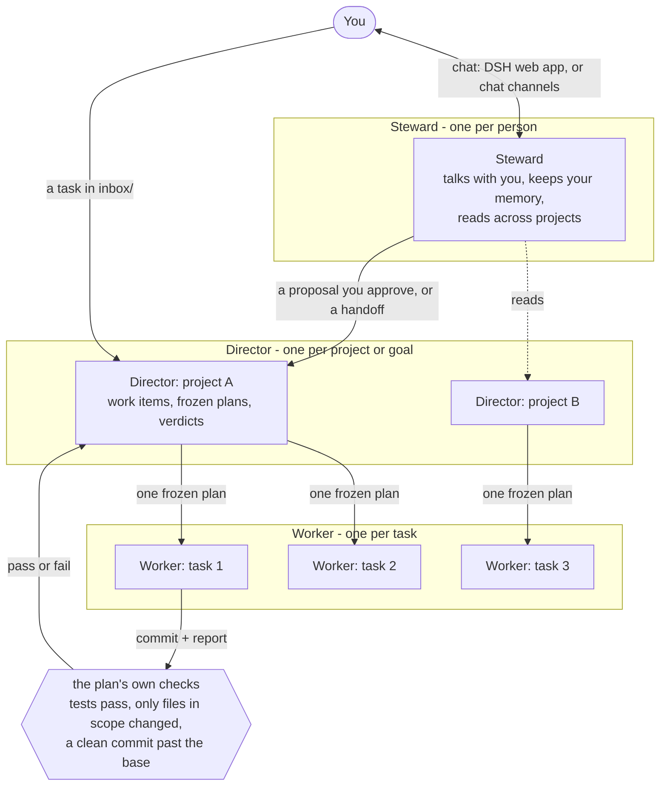

# dsh-director

A resident director and its native workers, as a plugin for DSH (DeepSeek Harness). The
director takes work, freezes each piece into a todo plan from a reviewed template, hands each
plan to a native DSH worker, checks what the worker delivered, and sleeps when nothing is left.

Where work comes from and where it is recorded belongs to a *host*. This README is about the
host built into the plugin, `hosts/local.mjs`: no server, no database, one DSH process and a
directory of plain files. (An external host replaces it; the repository's backend adapter in
`../dsh-driver` is one. Its install route is in the repository's top-level README.)

What the local host gives the director: work items in `work.json`, notes in `notes.md`, tasks and
answers dropped into `inbox/`, questions to you in `questions.json`, a progress log, todo plans and
native workers. What it does not have: a dependency graph, evidence or reviews, a dashboard, chat
channels (the Slack and WeChat channel plugins need a host that provides channels; next to this
host they do not load), or several directors coordinating.

## Three levels, and why

The plugin runs three kinds of DSH session, and each does one job:



| level | lives | its context holds | it may | it may not (enforced by `roles.json`, not by asking nicely) |
|---|---|---|---|---|
| **Steward** | one per person, for good | your conversation, your memory, a summary of every project | talk with you, remember, read projects, propose actions for you to approve, ask you questions; on a host that provides them, chat channels and handing work to a director | touch any project's files: no `bash`, `read`, `write`, `edit`, no workers, no plans |
| **Director** | one per project or goal, its own `root` and session | that project's work items, notes, plans and verdicts | pick a template, freeze a plan, dispatch a worker, check what came back, ask you, sleep | - (it holds the full tool set; by protocol it plans and checks rather than doing the task) |
| **Worker** | one per task, until the plan is finished | one frozen plan: the goal, its items, the files in scope, the commands that decide | edit files in scope, run commands, commit, report each item | start workers, create or finish plans, ask you, go dormant |

Why split it this way:

- **Each context holds one job.** A long conversation with you does not crowd a project's state out
  of the director's context, and a project's history does not crowd a task out of the worker's.
  Each level compacts what it alone needs, and loses less when it does.
- **Whoever does the work does not grade it.** The plan, with the commands that decide it, is
  frozen before the worker starts; the worker cannot finish its own plan (`todo_finish` is the
  director's), and the director re-runs the checks itself. To review a commit it fans it out to
  fresh workers that did not write it (the `find_verify` template: finders, then verifiers that try
  to refute each finding). "Done" is a command's exit code, not a sentence.
- **The right model at each level.** Workers can run a cheaper, faster model (`agentOptions` of
  `tool-subagent`) while the director, which decides, runs a stronger one.
- **A small blast radius.** The steward is the one that reads what comes from outside (your
  messages, mail, web pages, chat groups), and it has no hands on any project; a worker sees one
  plan and cannot start more workers or plans of its own.
- **Failures stay small, and resume.** A worker that crashes leaves its plan and the project's
  state behind; a restarted director resumes its session and the workers a restart interrupted; a
  restarted steward keeps its memory.
- **Idle costs nothing.** A director with nothing to do sleeps (`idle_dormant`) until a task or an
  answer lands in its `inbox/`; nothing polls a model in a loop.
- **Projects scale out side by side.** Each director has its own `root` and session, so several run
  on one machine without seeing each other's work.

On the local host described here, *you* are the bridge between the levels: you talk to the steward
in DSH's web app ([Talk to it](#talk-to-it)), it proposes a project, you approve it, and you start
its director. An external host (a backend) adds the plumbing, and with it the steward becomes the
one place you run things from:

- **Chat channels.** The channel plugins next to this one (`../dsh-channel-slack`,
  `../dsh-channel-wechat`) load when the host declares the `channels` capability. Your bound Slack
  DM or WeChat account then reaches the steward like the web app does: a conversation it remembers,
  your words handed to the right director, the directors' questions pushed to you with a code you
  answer from the chat (`Q12 ...`), and a proposal decided by sending back its exact line. Binding
  an account, and the few switches that loosen a safeguard, stay on the host's own UI.
- **Family group chats**, where it answers only from what that group may know.
- **Connections**: outside tools (search, documents, image generation) it may call, with an
  outward action confirmed by the person who asked first, and a pause on tools that send things out
  once it has read outside content.

None of it gives the steward hands on a project: what you ask for from a chat still reaches a
project only as a director's plan.

## Prerequisites

- **Linux.** Tested on x86_64. On Windows the plugin refuses to start. macOS is untested: plans
  work there, but `watch_process` cannot see jobs (it reads `/proc`).
- **DSH `0.2.2-rc.5`** (the release this plugin is tested on) and the Node.js it needs (tested
  with Node 24). Another DSH release starts with a warning in the DSH log. The npm package
  declares `engines.dsh` `>=0.2.2-rc.5 <0.3.0-0`: a DSH outside that range does not load it
  (`dsh plugin --profile <name> allow-version` accepts the risk for one exact version).
- **pnpm**, to install the plugin from npm: `dsh plugin` runs it in the profile, and stops with
  `pnpm was not found` without it (`npm install -g pnpm`). A checkout needs none.
- **python3 with PyYAML**, for the todo package. On Debian and Ubuntu: `sudo apt install python3-yaml`
  (their python3 has no pip, and pip refuses to install into it). Elsewhere:
  `python3 -m pip install -r requirements.txt`, or in a venv
  (`python3 -m venv <dir> && <dir>/bin/pip install -r requirements.txt`, then set
  `todo: { python: <dir>/bin/python3 }` in the config below).
- **git**, for plans and their delivery, with `user.name` and `user.email` set
  (`git config --global user.name ...`, `git config --global user.email ...`): workers commit.
- **A model key.** DSH's built-in DeepSeek route, provider `deepseek-official`, reads
  `DEEPSEEK_API_KEY` (from the environment or DSH's credential store). Any other model behind an
  OpenAI-compatible endpoint (a self-hosted server, a gateway) works too: see
  [Another model](#another-model).

At startup the local host checks python3, PyYAML and git and refuses to start, naming each
one that is missing.

## Use a profile of its own

**Never add this plugin to a profile you use for anything else.** It takes over every session
of its DSH process: the session named by `sessionId` is the director and every other session
is treated as a worker (fewer tools, no subagents, a worker's prompt). If the director cannot start, the
whole DSH process exits.

DSH's shipped profiles cannot run it either: in `web` the plugin waits forever for the
compaction service, in `headless` for the credentials service (the log says
`pending (waiting for service: ...)` and nothing else happens). `web` waits because its bundle,
`@deepseek-ai/dsh-web-app`, turns DSH's `compaction-basic` off for the whole process (it runs
compaction inside its own presets), and the plugin needs that service; one line in the profile's
`cordis.patch.yml` turns it back on: `- { id: compaction-basic, disabled: false }` (see
[Talk to it](#talk-to-it)). Use a profile built on `@deepseek-ai/dsh-base` alone, as below, or on
it and `@deepseek-ai/dsh-web-app` with that line.

## 1. Install

Two routes: from npm (for using it), or from a checkout of this repository (for changing it).
Both end in a profile named `director`; only how the plugin gets into it differs.

### From npm

```sh
npm install -g @deepseek-ai/dsh@0.2.2-rc.5 pnpm
sudo apt install python3-yaml git       # Debian/Ubuntu; elsewhere: python3 -m pip install PyYAML
dsh plugin --profile director add aitelier-dsh-director
```

The last line creates the profile (`${DSH_HOME:-$HOME/.dsh}/profiles/director`, built on
`@deepseek-ai/dsh-base`), installs the package `aitelier-dsh-director` into it and adds it to the
profile's bundles. The package's own layer (`cordis.patch.yml`, applied after `dsh-base`) turns
off the DSH tools the director's protocol does not use (`hmr`, `tool-subagent-fork`,
`tool-workflow`, `plan-mode`, `tool-todo`) and inserts the plugin's two rows, `dsh-director` and
`director-local`. What it cannot know, where the director keeps its files and which model it and
its workers use, goes into the profile's own patch: [section 2](#2-write-the-profile).

`dsh plugin --profile director remove aitelier-dsh-director` takes it out again; another version
is `dsh plugin --profile director add aitelier-dsh-director@<version>`.

### From a checkout

```sh
npm install -g @deepseek-ai/dsh@0.2.2-rc.5
cd integrations/dsh-director            # in your checkout of this repository
sudo apt install python3-yaml           # Debian/Ubuntu; elsewhere: python3 -m pip install -r requirements.txt
```

The profile then names the plugin's files by their path, and nothing is installed into it
([section 2](#2-write-the-profile), "From a checkout").

On either route, `npm install -g` writes into Node's global prefix. With a Node installed for
the whole system that prefix belongs to root; instead of `sudo`, give npm one of your own and put
its `bin` on your `PATH` (in `~/.bashrc` or wherever your shell reads it):

```sh
npm config set prefix ~/.npm-global
export PATH=~/.npm-global/bin:$PATH
```

## 2. Write the profile

`ROOT` is where the director keeps its files; pick any directory. Paths must not contain spaces
(they are written into YAML unquoted).

### From npm

The profile exists already (`dsh plugin ... add` made it). Its `cordis.patch.yml` is yours, and
is applied after every bundle's layer; replace it with the rows only you can fill in:

```sh
ROOT=$HOME/director
PROFILE=${DSH_HOME:-$HOME/.dsh}/profiles/director
mkdir -p "$ROOT/inbox"
cat > "$PROFILE/cordis.patch.yml" <<EOF
# Workers: DSH's native subagent tool, on the model the workers should use. A patch replaces a
# row's whole config, so provider and toolName are restated next to agentOptions.
- id: tool-subagent
  config:
    provider: spawn
    toolName: subagent
    agentOptions: { provider: deepseek-official, model: deepseek-flash }
# The director's host: its files, and the model the director runs on.
- id: director-local
  config:
    root: $ROOT
    provider: deepseek-official
    model: deepseek-flash
EOF
dsh --profile director --dump-config     # the composed layers, without starting anything
```

The package carries no `tool-subagent` row of its own: this one would replace it whole anyway.
Without this row the workers run on `dsh-base`'s (`provider: spawn`, no `agentOptions`), that
is on DSH's default model rather than one you chose. Without `director-local`'s config the
director refuses to start (`missing config: root`, see
[When it does not start](#when-it-does-not-start)).

### From a checkout

Run this from `integrations/dsh-director`. The profile lists only `dsh-base`, and its patch also
does what the package's layer does, naming the plugin's files by their path:

```sh
PLUGIN=$PWD
ROOT=$HOME/director
PROFILE=${DSH_HOME:-$HOME/.dsh}/profiles/director
mkdir -p "$PROFILE" "$ROOT/inbox"
cat > "$PROFILE/package.json" <<'EOF'
{ "private": true, "dsh": { "profile": { "bundles": ["@deepseek-ai/dsh-base"] } } }
EOF
cat > "$PROFILE/cordis.patch.yml" <<EOF
- id: hmr
  disabled: true
# Workers: DSH's native subagent tool, on the model the workers should use.
- id: tool-subagent
  config:
    provider: spawn
    toolName: subagent
    agentOptions: { provider: deepseek-official, model: deepseek-flash }
# Built-in tools the director's protocol does not use.
- { id: tool-subagent-fork, disabled: true }
- { id: tool-workflow, disabled: true }
- { id: plan-mode, disabled: true }
- { id: tool-todo, disabled: true }
- insert:
    - id: dsh-director
      name: $PLUGIN/index.mjs
    - id: director-local
      name: $PLUGIN/hosts/local.mjs
      config:
        root: $ROOT
        provider: deepseek-official
        model: deepseek-flash
EOF
```

In either route, `root`, `provider` and `model` are required. Optional keys of
`director-local`'s `config`:

| key | default | what it does |
|---|---|---|
| `sessionId` | `director` | the director's DSH session; a restart resumes it. Give each director on one machine its own |
| `objective` | none | the director's standing goal (its DSH goal), set once on the first start. This is the only standing goal of a director started here: the backend's mandate (`integrations/dsh-driver/goal.md` and any deployment override of it) is read only by backend-managed directors |
| `permissionPreset` | none | a DSH permission preset for the director and its workers (below) |
| `dshEntry` | the running `dsh`, symlinks resolved | DSH's `lib/bin.js`; set it when DSH's libraries are not found from there |
| `todo` | `{ python: 'python3' }` and the plugin's own todo package | `python` names another interpreter |
| `pollMs` | `2000` | how often `inbox/` is read |
| `sessionEnv` | `DIRECTOR_LOCAL_SESSION_<hash of root>` | the variable that tags every process this DSH starts with the director's session; the plugin sets it itself. One per `root`, so two directors started side by side do not count each other's jobs. One exception, one way: a director B started from inside director A's job (A's shell) inherits A's variable as well as its own, so A counts B's DSH and every job B starts as A's own background jobs, and A's `idle_dormant` is refused with `background_processes` while they run; B does not count A's. Start each director from its own shell. A name you set must not start with `DSH_`: DSH drops those from every model shell |

### Another model

The profile's patch (either route) names DeepSeek's route twice: `agentOptions` in the
`tool-subagent` row (the workers) and `provider`/`model` in `director-local`'s `config` (the
director). For any other model, add a route for it to the same patch, as the `llm-pi-ai` row's
config, and name that route and model in both places instead. An OpenAI-compatible endpoint, for
example a server on your own machine:

```yaml
- id: llm-pi-ai
  name: "@deepseek-ai/dsh-llm-pi-ai"
  config:
    providers:
      local:                          # the route's name: use it as `provider` in the profile
        apiKeyEnv: LOCAL_API_KEY      # the environment variable holding its key
        api: openai-completions
        baseURL: http://127.0.0.1:8000/v1
        models:
          - id: my-model              # use it as `model` in the profile
```

Put it in every profile that uses the route (a director's, a steward's), not in DSH's
`${DSH_HOME:-$HOME/.dsh}/settings.yaml`: DSH `0.2.2-rc.5` moves that file into the first profile
it starts (as this same row of that profile's `cordis.patch.yml`) and renames it
`settings.yaml.imported`, so a profile started later has no route
(`Model completion: no adapter registered for provider "local"`). A patch replaces a row's whole
config, so the row lists every route that profile uses.

```yaml
    agentOptions: { provider: local, model: my-model }     # in the tool-subagent row
...
    provider: local                                        # in director-local's config
    model: my-model
```

Start DSH with that variable set (`export LOCAL_API_KEY=...`) instead of `DEEPSEEK_API_KEY`. The
model must support tool calls, and do them well: the director and its workers do everything
through tools, and a steward even more so (each of its turns is a run of tool calls). A small
quantized model has been seen calling `idle_dormant` over and over in one steward turn; if yours
does that, use a larger one. A gateway that refuses every request although the address and key
are right usually wants `compat: { supportsDeveloperRole: false, maxTokensField: max_tokens }` on
the route; DSH's own guide to models (`docs/user/guide/providers.md` in the DSH repository) lists
the rest.

## 3. Permissions

By default DSH lets the director and its workers write only inside the directory DSH was
started in (and temporary directories); a write anywhere else needs an approval, and this
profile has no client to approve it in, so it fails (`Permission denied`). Two ways to change
that:

- start DSH from a directory that contains every checkout the workers will change (for example
  from your home directory, if your checkouts are under it), or
- give the director full access: `DSH_PERMISSION_MODE=danger-full-access` in DSH's environment
  (the whole process), or `permissionPreset: danger-full-access` in the config above (the
  director's session; its workers inherit it).

Full access means the model can change and delete anything your user can, and run any
command, with nothing asking you first. Use it for a user account or machine you can lose.

## 4. Start it

```sh
export DEEPSEEK_API_KEY=...             # your key
dsh --profile director
```

It keeps running until you stop it: Ctrl-C, or, when it runs in the background, `kill <pid>`
(SIGTERM, which stops it the same way). Never start a second copy to check on a running one:
`dsh --profile director --help` boots the whole profile too, and exits with
`SessionAlreadyOwnedError` because the first one owns the session. Started again, it resumes the
same session, and workers a restart interrupted are resumed. The first thing to check when
nothing seems to happen is `$ROOT/progress.jsonl`; a failed model call (no key, an unknown model)
is also printed to stderr as `dsh-director failed: ...`. Its lines can be long (a report may
carry a whole model answer); to see only when, which phase and what error:

```sh
jq -c '{at, phase, error}' "$ROOT/progress.jsonl" | tail -20
# without jq:
python3 -c 'import json,sys; [print(r.get("at"), r.get("phase"), str(r.get("error") or "")[:300]) for r in map(json.loads, open(sys.argv[1]))]' "$ROOT/progress.jsonl" | tail -20
```

## 5. Give it work

Every file that lands in `$ROOT/inbox/` wakes the director once with its text, then moves to
`inbox/done/`. Name the checkout to work in (a git repository) and what done means:

```sh
cat > "$ROOT/inbox/task-1.json" <<'EOF'
{ "task": "In the git checkout /home/me/src/parser, make `npm test` pass; the failure is in test/dates.test.js." }
EOF
```

The director records the task as a work item in `work.json`, picks a template and freezes a
plan, then dispatches a worker for it. The templates the plugin ships, in
`todo/todo_templates/`:

| template | for |
|---|---|
| `change_files` | change named files, nothing outside a scope |
| `docs_change` | write or revise documentation files inside a scope |
| `code_change` | change code inside a scope and pass the repository's own test command |
| `test_fix` | make one failing test command pass, touching only a scope |
| `investigate` | write a JSON report with required keys |
| `find_verify` | read-only review: one finder per angle, then one verifier per finding |
| `cost_audit` | read-only audit of what the project's checks cost |

A plan is never improvised: when no template fits, add a YAML file next to these (copy the
closest one). `DSH_TODO_TEMPLATES=<dir>` in DSH's environment replaces the whole set with
the templates in `<dir>`.

When every item of a plan passed, the director finishes it: the worker's commits are in the
checkout, and a git bundle and a report are under `$ROOT/state/todo/finish/<attempt id>/`.

## 6. Watch and answer

Everything is under `$ROOT`:

| file | what is in it |
|---|---|
| `progress.jsonl` | one line per phase: `running`, `waiting`, `dormant`, or `failed` with the error |
| `work.json` | the work items, their state and who holds them |
| `notes.md` | the director's notes |
| `questions.json` | the director's questions to you, `open`, `answered` or `withdrawn` |
| `state/` | the plans and the runtime's own records; do not edit |

To answer an open question, drop its answer into the inbox (the director gets it as an event):

```sh
printf '%s\n' '{"answer": "Yes, drop Node 18."}' > "$ROOT/inbox/answer-<question id>.json"
```

The plugin also registers DSH commands for this (`/questions`, `/answer <id> <text>`), but the
profile above has no chat client to type them in; files are the way in (or add DSH's web app to
the profile, as in [Talk to it](#talk-to-it)).

## A steward instead of a director

The same two plugins can run a *steward*: one long-running assistant you talk to, which keeps
your memory and looks across your projects, and never does project work itself. Add these keys
to `director-local`'s `config`:

| key | what it does |
|---|---|
| `rootRole: steward` | the session named by `sessionId` is the steward, not a director |
| `memory: { userId: <name> }` | your memory: a git repository under `~/.local/share/dsh-director/memory/<name>/` (`root` puts it elsewhere; keep it outside anything mounted into containers). `timeZone` (an IANA name, default UTC) dates what it shows |
| `projectsDir` | optional: a directory whose every subdirectory is one local host root (a project); below |
| `ownerLanguage` | optional, default `en`: `en` or `zh` (by its first part, so `zh-CN` is `zh`; anything else is `en`). The language of the fixed text the plugin shows: the reply phrases in the steward's prompt, the memory tools' lines and labels, the weekday in the clock line |

`projectsDir` must exist (create it; one that does not reads as no projects). One project is a
subdirectory named by its id (letters, digits, `_ . -`, starting with a letter or digit; other
names are skipped), laid out like a director's `root`:

| file | what the steward reads |
|---|---|
| `project.json` | `title` and `goal` (and `project_id`, `proposal_id`, `created_at` when the steward made it) |
| `work.json` | `{ "items": [{ "id", "title", "state", "holder"? }] }`: counts by state, and the open items |
| `questions.json` | the open questions of that project's director |
| `progress.jsonl` | its last line: the director's phase |
| `notes.md` | the director's notes (the steward writes the goal into it when it makes the project) |

The steward only reads them; a director started with `root` set to that subdirectory works there.

What a steward on this host can do:

- talk with you. Every turn you write to it in its DSH's web app ([Talk to it](#talk-to-it)) is recorded
  into your memory, with its replies in that turn, by the plugin itself; `memory_search` finds
  them, `memory_note` and `memory_profile_update` keep what it concluded or what you prefer. A
  file in `inbox/` wakes it as an event, like a director, and is not your words, so it is not
  recorded.
- with `projectsDir`: read every project there (`portfolio_projects`, `portfolio_project`,
  `portfolio_conversation`) and propose one new project (`propose`, kind `create_project`). You
  decide with `/proposals`, `/approve <id>` and `/decline <id> [reason]`; an approved project is a
  new subdirectory with `project.json`, `notes.md`, `work.json` (one item per seed node, each
  `working` with no holder: open, and held by nobody yet) and an empty `inbox/`. Nobody works on it
  until you start a director for it yourself (a profile of its own, `root` set to that
  subdirectory).
- ask you questions (`ask_owner`), which you answer with `/questions` and `/answer <id> <text>`, or
  a file `inbox/answer-<id>.json` as above.
- forget, restore or purge one memory entry only when you type `/forget <id> [reason]`,
  `/restore <id>` or `/purge <id>`; `/profile` shows your resident profile. Its own
  `memory_forget` refuses here (a DSH command carries no message of yours it could cite).

What it cannot do here, because this host does not provide it:

- pass anything to a director (no `handoff`), read a director's letters, or propose to start,
  stop, archive or unarchive a director or project;
- reach you anywhere but this DSH: no dashboard, no Slack or WeChat (the channel plugins do not
  load next to this host), no family groups, no daily brief and no reminders;
- use connections: no MCP servers through a catalog, no confirmations, no attachments, PDF or
  office files, no `make_document` or `calculate`.

Its prompt is cut to match: `steward.md` is written for the fullest host, and each passage about
something this host does not provide (the dashboard, chat channels, the brief, family groups,
handoffs and letters, the connection catalog) is left out or replaced with what to do here
(`lib/steward-prompt.mjs`). The owner's language (`ownerLanguage`) then swaps the reply phrases
and fixed lines that are left (`lib/owner-text.mjs`). A `zh` host that provides everything gets
`steward.md` unchanged.

### Talk to it

The profile in section 2 has no client: the steward runs, but nothing you type reaches it. Make
the steward's profile like that one (say `--profile steward`, with the keys above in
`director-local`'s `config`), with a `root` of its own and `sessionId: steward`: neither may be a
director's. Give it DSH's web app as well. The web app,
`@deepseek-ai/dsh-web-app`, is a bundle DSH itself ships: it is not installed, only listed among
the bundles in the profile's `package.json` (`dsh plugin ... add @deepseek-ai/dsh-web-app` would
download a second copy from npm, and stops at its build scripts).

- From npm: write that `package.json` first, then add the package (`dsh plugin ... add` keeps the
  bundles already listed and appends its own):

  ```sh
  PROFILE=${DSH_HOME:-$HOME/.dsh}/profiles/steward
  mkdir -p "$PROFILE"
  cat > "$PROFILE/package.json" <<'EOF'
  { "name": "dsh-profile-steward", "private": true, "dsh": { "profile": { "bundles": ["@deepseek-ai/dsh-base", "@deepseek-ai/dsh-web-app"] } } }
  EOF
  dsh plugin --profile steward add aitelier-dsh-director
  ```

  On a profile that has the package already, add `"@deepseek-ai/dsh-web-app"` to the `bundles`
  list of its `package.json` by hand.
- From a checkout, its `package.json` is

  ```json
  { "private": true, "dsh": { "profile": { "bundles": ["@deepseek-ai/dsh-base", "@deepseek-ai/dsh-web-app"] } } }
  ```

Either way, its `cordis.patch.yml` also carries the line that turns the compaction service back
on (the web app turns it off, and the plugin then waits for it forever):

```yaml
- { id: compaction-basic, disabled: false }
```

Start it with

```sh
dsh --profile steward --no-open --port 8123
```

and open the address it prints after `dsh web:`. On another machine, forward the port first
(`ssh -L 8123:127.0.0.1:8123 <that machine>`) and open the same address here. Your turns there are
your conversation with the steward, and the commands above (`/proposals`, `/approve`, `/answer`,
`/forget` and the rest) are typed there too.

Only one DSH process can own the steward's session: a second `dsh --profile steward` exits with
`SessionAlreadyOwnedError`, and a separate `dsh web` cannot write to it (`session/writer-held`).
Talk to it through the web app of the process that runs it.

## Find it in DSH's plugin market

This repository publishes a plugin market index (DSH's index format 1) that lists this package:

```
https://raw.githubusercontent.com/linxuhao/AItelier/main/market/index.json
```

DSH reads market indexes only in a profile with its web app and the optional bundle
`@deepseek-ai/dsh-experimental-plugin-market-bundle` (shipped with DSH, off in every shipped
profile; list it among the profile's bundles like the web app above). There, add the address as
an index source on the Plugins page's Discover tab, or in the profile's patch:

```yaml
- id: plugin-market
  config:
    indexes: [https://raw.githubusercontent.com/linxuhao/AItelier/main/market/index.json]
```

Installing from Discover installs into the profile that web app runs in, and this plugin takes
over every session of its profile ([Use a profile of its own](#use-a-profile-of-its-own)). So
install it there only from a new profile made for it (the web app and the market bundle among its
bundles, like the steward's above), never from the one you work in; then write that profile's
patch ([section 2](#2-write-the-profile), and the steward's line for `compaction-basic`) and
start it again.

## When it does not start

DSH prints two lines and exits:

```
dsh exit cause: dsh-director startup: Error
dsh-director startup: <the reason>
```

A failure that carries a system error code names that code on the first line instead of
`Error`, for example a `rolesFile` that does not exist:

```
dsh exit cause: dsh-director startup: connection-level ENOENT
dsh-director startup: ENOENT: no such file or directory, open '/nonexistent/roles.json'
```

The second line is the one to read.

| reason | fix |
|---|---|
| `missing config: provider` (or `model`, `root`) | add it to `director-local`'s `config`; installed from npm, that is in the profile's own `cordis.patch.yml` ([section 2](#2-write-the-profile)) |
| `python not found` / `PyYAML is missing` | install python3 and PyYAML (Debian/Ubuntu: `sudo apt install python3-yaml`; elsewhere `python3 -m pip install -r requirements.txt`, or a venv); or set `todo.python` |
| `git not found` | install git |
| `cannot find @deepseek-ai/dsh-tools from config.dshEntry ...` | set `dshEntry` to the `lib/bin.js` of your DSH install |
| `Windows is not supported` | run it on Linux |

`pending (waiting for service: ...)` with no exit means the profile is not the one above.

A memory that cannot open does not stop a steward; its memory tools refuse instead, for the whole
run. At startup it says why on stderr, `dsh-director: memory unavailable: <the reason>`, and every
line of `progress.jsonl` carries `memory_unavailable: <the reason>` in its `error`.

| reason | fix |
|---|---|
| `memory: locked by process N` | another process has this memory open: a second DSH with the same `userId` and memory `root`. Stop it (`kill N`) and start again. A lock whose process is gone is taken over by itself at the next start; one left by a process that was killed hard (SIGKILL) while another process now has its number, as after a container restart, is removed by hand (`<memory root>/<userId>.lock`) while no DSH uses that memory. In Docker, run the container with `--init`, so exited processes are reaped |

## Releasing the package

`npm pack` in this directory builds what is published: `files` in `package.json` (the tests,
`standalone/`, `conformance/` and `tools/` stay out; `test/boundary.test.mjs` fails when a
runtime file would be left out). After `npm publish`, set that version's `publishTimestamp` in
the repository's `market/index.json` (`0` until then) to the registry's time of the version, in
Unix seconds:

```sh
npm view aitelier-dsh-director@0.1.0 time --json | node -e 'const t = JSON.parse(require("fs").readFileSync(0, "utf8"))["0.1.0"]; console.log(Math.floor(Date.parse(t) / 1000))'
```

A new version is a new entry in that file's `versions`, with `engines.dsh` equal to
`package.json`'s; `integrations/dsh-driver/market-index.test.mjs` checks both with DSH's own
validator.

## Checking this README

`standalone/scenario.mjs` runs this profile's shape (the same disabled tools, the same two
inserted plugins, no backend) with a scripted model instead of a real one: two tasks, two
plans, two workers, a watched background job, and dormancy at the end.

```sh
node standalone/scenario.mjs <your DSH>/lib/node_modules/@deepseek-ai/dsh/lib/bin.js
```
